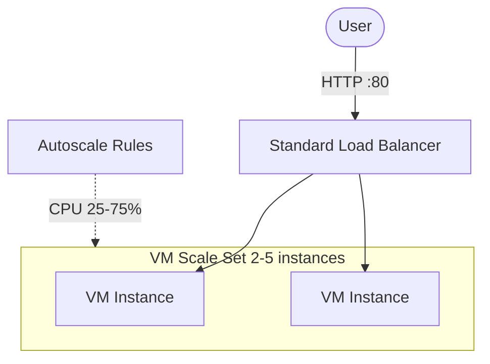

# Azure VM Scale Sets + Load Balancer (Terraform)

> Autoscaling Linux VM Scale Set behind a Standard Load Balancer, with CPU-based autoscale rules — provisioned with Terraform.
> **Author:** Muhammad Ahmad · **IaC:** Terraform · **Cloud:** Azure


---

## 📌 Overview

- A **Standard Load Balancer** with a public IP, HTTP health probe, and load-balancing rule.
- A **Linux VM Scale Set** (Ubuntu 22.04) whose instances install nginx via cloud-init and register in the LB backend pool.
- **Autoscale** rules scale out above 75% CPU and in below 25%, between 2 and 5 instances.

## 🏗️ Architecture

> 🎨 **Interactive diagram (industry-standard icons):** [open in Lucid — page 19](https://lucid.app/lucidchart/3da75ce3-ea66-4296-81b3-00d20a60435b/edit)



## 🚀 Deploy

```bash
cd terraform
az login
export TF_VAR_admin_password='YourStr0ng!Passw0rd'
terraform init
terraform apply

terraform output application_url
```

## 🧹 Clean up

```bash
terraform destroy
```

## 💰 Cost note

VM instances and the Standard Load Balancer bill hourly. Uses small `B1s` VMs; destroy when done.

## 🔐 Production hardening (next steps)

- Use **SSH keys** instead of a password; integrate with Key Vault.
- Add **rolling/automatic** upgrade mode and health extension.
- Front with **Application Gateway** (L7) + WAF.

---

*Built and maintained by **Muhammad Ahmad**.*
