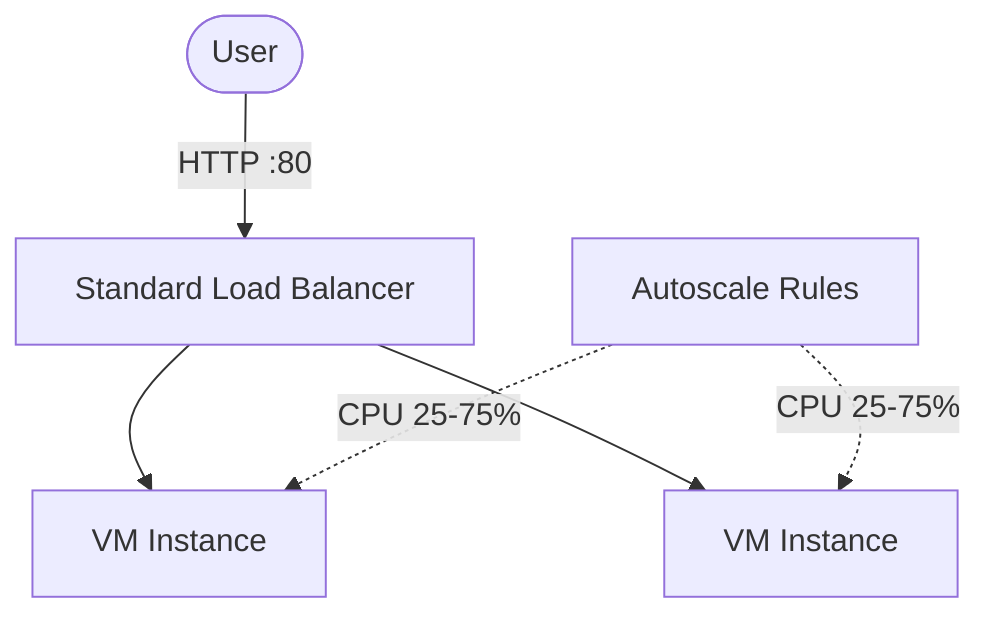

# Architecture Diagram — Azure VMSS + Load Balancer

## Lucid diagram

- **View:** https://lucid.app/lucidchart/df4668a8-3ab8-419f-bddf-50b281878e02/view
- **Edit:** https://lucid.app/lucidchart/df4668a8-3ab8-419f-bddf-50b281878e02/edit

## Lucid prompt (reusable)

```
Create an Azure architecture diagram titled "Azure VM Scale Sets + Load Balancer".
A User sends HTTP traffic to a Standard Load Balancer, which distributes to a VM Scale
Set of 2-5 Linux instances. Autoscale rules adjust the instance count based on CPU
(scale out above 75%, in below 25%). Label the arrows. Clean, professional Azure colors.
```

## Mermaid source


